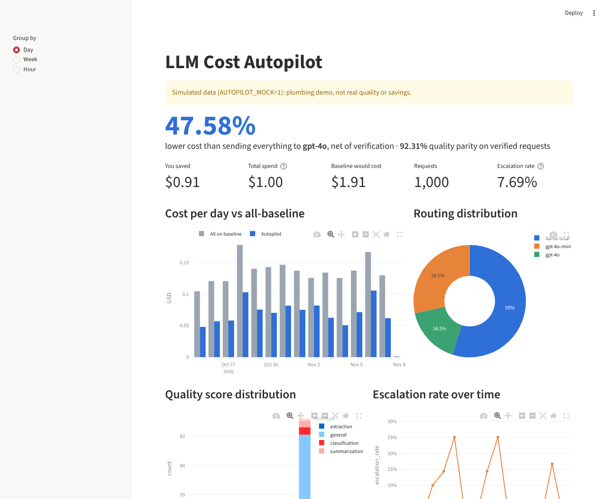
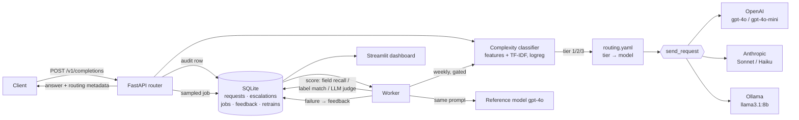

# LLM Cost Autopilot

**A routing layer that sends every LLM request to the cheapest model that can handle it, then checks that it was right.**

> Simulated 1,000-request load test: **47.6% lower cost** than sending everything to GPT-4o,
> *after* paying for verification (56.8% before), with **92.3% quality parity** on verified requests.
>
> ⚠️ These figures come from the offline simulator (`AUTOPILOT_MOCK=1`). They show that routing,
> verification, escalation and retraining work end to end. They don't measure real model quality.
> Run the same load test with real API keys (see [Real run](#real-run)) and replace this
> block with those numbers before you publish anything.



Callers send one OpenAI-style request and never choose a model. The router:

1. scores the request's complexity (tier 1 simple / 2 moderate / 3 complex),
2. sends it to the model mapped to that tier in `config/routing.yaml`,
3. re-runs a sample of requests on the top model in the background and scores agreement,
4. escalates failures, and turns each failure into a training example for the classifier.

---

## Using with Claude

`SKILL.md` (at the repo root, and mirrored in `.claude/skills/llm-cost-autopilot/` so Claude Code
picks it up when you open the repo) teaches Claude how to run, tune and interpret the autopilot.
To use it in Claude Cowork, add the root `SKILL.md` as a skill.

## Architecture



| Phase | What | Where |
|---|---|---|
| 1 | Model registry, unified `send_request()`, 10-prompt baseline across all models | `registry.py`, `providers.py`, `baseline.py`, `config/models.yaml` |
| 2 | 3 tiers, 214 hand-labeled prompts, scikit-learn classifier, YAML routing map | `features.py`, `classifier.py`, `routing.py`, `data/labeled_prompts.jsonl`, `config/routing.yaml` |
| 3 | Per-task quality thresholds, async verifier, auto-escalation, feedback → retrain | `verifier.py`, `engine.py`, `worker.py` |
| 4 | SQLite audit trail + JSON logs, cost dashboard, headline metric | `db.py`, `analytics.py`, `dashboard/app.py` |
| 5 | FastAPI service, config endpoints, docker-compose | `api.py`, `Dockerfile`, `docker-compose.yml` |
| 6 | 1,000-prompt load test, savings report, case study | `loadtest.py`, `report.py`, `results/` |

## Setup

Python 3.11+.

```bash
python -m venv .venv
source .venv/bin/activate          # Windows: .venv\Scripts\activate
pip install -e ".[dashboard,dev]"
autopilot train                    # trains on data/labeled_prompts.jsonl -> var/classifier.joblib
pytest                             # 18 tests, offline
```

### Offline demo (no keys, no spend)

```bash
export AUTOPILOT_MOCK=1            # Windows PowerShell: $env:AUTOPILOT_MOCK="1"
autopilot baseline                 # Phase 1.3: 10 prompts x 5 models -> results/baseline_*.csv
autopilot loadtest -n 1000 --spread-days 14
streamlit run dashboard/app.py     # http://localhost:8501
```

`--spread-days` back-dates the simulated requests so the over-time charts have something to show.
It refuses to run outside mock mode.

### Real run

```bash
cp .env.example .env               # add OPENAI_API_KEY and ANTHROPIC_API_KEY, set AUTOPILOT_MOCK=0
ollama pull llama3.1:8b            # or change tier 1 to claude-haiku in config/routing.yaml
autopilot baseline                 # check every provider answers, and measure latency
autopilot loadtest -n 500          # roughly $1–3 at list prices with the default 10% verification
```

### Docker

```bash
docker compose up --build                  # api :8000, worker, dashboard :8501 (mock by default)
AUTOPILOT_MOCK=0 docker compose up         # real providers, keys from .env
docker compose --profile local up          # also starts Ollama
docker compose exec ollama ollama pull llama3.1:8b
```

The API container trains the classifier on first boot. The API, worker and dashboard share one
volume holding the SQLite database, logs and classifier.

## API

```bash
curl localhost:8000/v1/completions -H 'content-type: application/json' -d '{
  "messages": [{"role": "user", "content": "Extract the invoice number from: INV-20931, $4,812.50"}],
  "routing": {"verify": "auto"}
}'
```

The response follows the OpenAI chat-completion shape, plus a `routing` block:

```json
"routing": {
  "selected_model": "llama-local", "served_by": "llama-local",
  "tier": 1, "confidence": 0.97, "task_type": "extraction",
  "reason": "classified tier 1 (simple) with confidence 0.97; tier 1 -> llama-local",
  "cost_usd": 0.0, "baseline_cost_usd": 0.00021, "saved_usd": 0.00021,
  "verification": "queued", "escalated": false
}
```

| Endpoint | Purpose |
|---|---|
| `POST /v1/completions` | Route and answer. `model` is accepted but ignored. `routing.verify`: `auto` (sampled, async), `always`, `sync` (inline if `latency_budget_ms` allows, else async), `off` |
| `GET /v1/requests/{id}` | Audit row. After async verification, `escalated_text` holds the better answer if the cheap one failed |
| `GET /v1/models` | Registry with prices and which tiers each model serves |
| `GET /v1/stats?days=7` | Savings summary: gross/net reduction, parity, escalation rate, routing mix |
| `GET` / `PUT /v1/routing-config` | Read or change the tier map, fallbacks, sample rate and thresholds without redeploying. Validated, then written to `routing.yaml` |
| `POST /v1/retrain?force=true` | Retrain with accumulated feedback (still gated, see below) |

## How the pieces work

**Classifier.** 13 hand-built features (approximate token count; counts of simple, moderate,
complex and creative verbs; constraints; output-format words; whether context is provided and what
share of the prompt it takes; multi-step markers; questions) plus TF-IDF over the *instruction* part
of the prompt, fed to logistic regression. Results on the 214-prompt set: **91% 5-fold CV**
(±2%), 98% on one held-out split, and 1.9% under-routing. Under-routing (predicting a lower tier than
the true one) is the error that costs quality, so it's tracked separately. When the classifier's top
probability is below `min_confidence` (0.55), the request goes up one tier.

**Quality checks, per task type** (`config/routing.yaml → verification.thresholds`):

| Task (detected from the instruction) | Check against the reference model's answer | Pass |
|---|---|---|
| extraction | field recall (JSON keys/values, or salient tokens: numbers, emails, IDs) | ≥ 0.8 |
| classification | label match | exact |
| summarization | LLM-as-judge, 1–5 | ≥ 4 |
| general | LLM-as-judge, 1–5 | ≥ 4 |

**Escalation.** A failed check is logged in `escalations` with the original model, escalated model,
cost delta and quality gap. The reference answer is stored on the request. In `sync` mode the
caller gets that better answer directly, but only if the cheap call's latency plus the reference
model's expected latency fits inside the caller's budget. Otherwise verification falls back to async.

**Feedback loop.** Each failure becomes a training example labeled one tier above the tier it was
routed at. If the same prompt fails again it moves up again. The worker checks hourly and retrains
when at least 7 days have passed and at least 5 new examples exist. A retrain is a *candidate*: it
replaces the live model only if its CV accuracy is within `max_cv_drop` (0.05) of the live
model's. I added this gate after a simulated run in which retraining on failures lowered accuracy.
Some prompts are hard for reasons the features can't capture, and learning them as labels can make
the classifier worse on everything else.

## What verification costs (the main tuning knob)

To verify a request you pay for the reference model's answer again, plus a judge call for
open-ended tasks. The judge prompt contains the request, the reference answer and the candidate
answer, so it costs more than the original call. Projected from the simulated run:

| sample rate | net reduction |
|---:|---:|
| 5% | ~52% |
| **10% (default)** | **~47%** |
| 25% | ~32% |
| 50% | ~8% |
| 100% | negative: verification costs more than routing saves |

The report recomputes this table from your own traffic on every run. The dashboard's headline is
always the **net** number.

## Prices

`config/models.yaml`, USD per 1M tokens (input / output), checked 2026-11-07:
GPT-4o $2.50 / $10.00 · GPT-4o-mini $0.15 / $0.60 · Claude Sonnet 4.5 $3.00 / $15.00 ·
Claude Haiku 4.5 $1.00 / $5.00 · local Llama $0 (hardware and electricity not modeled).
Recheck them before you quote any savings. Newer Claude models (the 5.x family) can replace the
4.5 entries by changing `model_id` and the two prices.

## Known limitations

- **Simulated numbers.** In mock mode, a prompt's difficulty comes from the human labels (plus 8% of
  prompts made secretly harder), and the judge measures word overlap. That is enough to exercise every
  code path; it is not evidence about how real models perform.
- **Easy load-test pool.** The templated load-test prompts are more keyword-obvious than real traffic,
  so classifier accuracy on them (~97%) overstates what you'll see in production. The 5-fold CV figure
  on the hand-labeled set is the more honest number.
- **Labels are unverified.** All 214 labeled prompts ship with `verified: false`. I drafted them to
  cover the edge cases: short hard prompts, long easy prompts, moderate prompts with lots of context.
  Review every label before you rely on the classifier.
- **Baseline cost estimate.** The baseline applies GPT-4o prices to the routed model's token counts.
  Tokenizers differ by a few percent. Where verification ran, the real GPT-4o cost is in `verify_cost`.
- **The reference model isn't ground truth.** Verification measures *agreement with GPT-4o*. When the
  cheap model is right and GPT-4o is wrong, that request is counted as a failure.
- **Docker compose wasn't tested end to end.** The image couldn't be built in the environment where
  this was written (no access to Docker Hub). The same entrypoint commands were run directly and pass.

## Repo layout

```
config/            models.yaml (registry + prices), routing.yaml (tier map, thresholds, sampling)
data/              labeled_prompts.jsonl (214, hand-labeled), loadtest_prompts.jsonl (generated)
src/cost_autopilot api, engine, classifier, features, providers, verifier, worker, db, report, cli
dashboard/app.py   Streamlit dashboard
scripts/           make_dataset.py (source of the labeled set)
results/           baseline runs, cost_savings_report.md, case_study.md, charts, dashboard screenshot
tests/             18 offline tests
var/               runtime state: SQLite db, JSON logs, classifier (gitignored)
```
