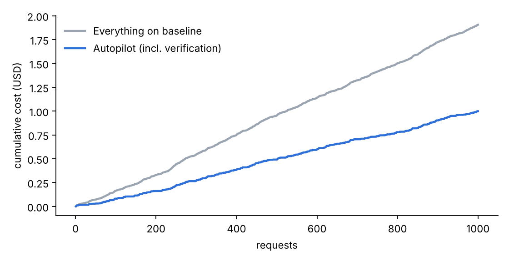
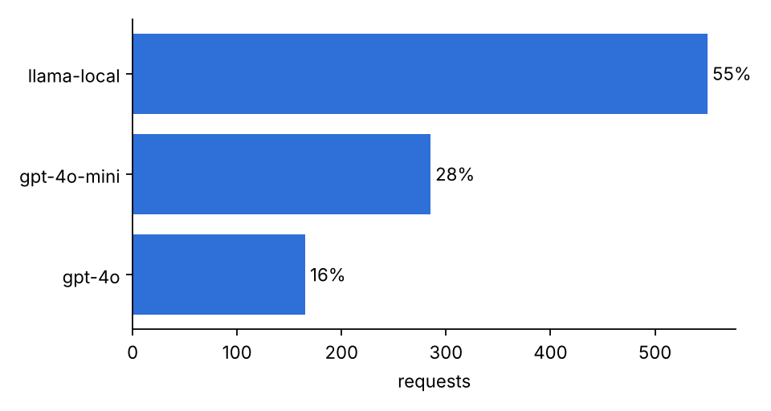
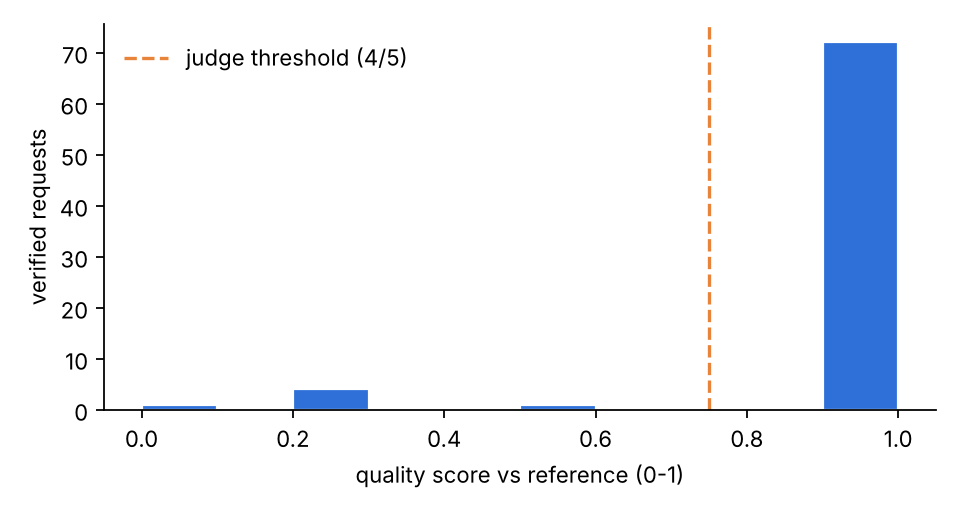

# LLM Cost Autopilot - cost savings report

Generated 2026-11-07 18:19 (simulated).

> **Simulated run (AUTOPILOT_MOCK=1).** These numbers come from the offline simulator. They prove the routing, verification and feedback plumbing work end to end; they are not a measurement of real model quality or real savings. Re-run with real API keys before quoting any of them.

## Headline

**47.58% lower cost than sending everything to the baseline model, with
92.31% quality parity on verified requests.**

| metric | value |
|---|---:|
| requests | 1000 |
| baseline cost (all on baseline model) | $1.9063 |
| routed cost | $0.8244 |
| verification overhead | $0.1749 |
| **total spend** | **$0.9993** |
| gross reduction (before verification) | 56.75% |
| **net reduction (after verification)** | **47.58%** |
| verified requests | 78 |
| quality parity | 92.31% |
| escalation rate (of verified) | 7.69% |

Quality parity = share of verified cheap-model answers that met the task's threshold against the
reference model's answer. It is measured on a sample, not on every request.

## What verification costs

Verifying a request means paying for the reference model's answer again, plus a judge call for
open-ended tasks. Projected from this run's measured per-request overhead:

| sample rate | projected verification cost | projected net reduction |
|---:|---:|---:|
| 5% | $0.0936 | 51.8% |
| 10% | $0.1872 | 46.9% |
| 25% | $0.4680 | 32.2% |
| 50% | $0.9360 | 7.7% |
| 100% | $1.8720 | -41.4% |

This is the main tuning knob: verify enough to catch routing drift, not so much that the check
eats the savings.

## Routing distribution

| model | requests | share | cost |
|---|---:|---:|---:|
| llama-local | 550 | 55.0% | $0.0000 |
| gpt-4o-mini | 285 | 28.5% | $0.0352 |
| gpt-4o | 165 | 16.5% | $0.7892 |

## Quality by task type

| task | verified | quality parity | mean score |
|---|---:|---:|---:|
| classification | 6 | 83.3% | 0.83 |
| extraction | 15 | 93.3% | 0.97 |
| general | 51 | 92.2% | 0.94 |
| summarization | 6 | 100.0% | 1.00 |

## Escalations

| from | to | escalations | total cost delta | mean quality gap |
|---|---|---:|---:|---:|
| gpt-4o-mini | gpt-4o | 1 | $0.0001 | 1.00 |
| llama-local | gpt-4o | 5 | $0.0087 | 0.46 |

## Classifier

Held-out accuracy 0.9259 (n=54), 5-fold CV 0.903
± 0.03, under-routing rate 0.0185 (true tier above predicted
tier: the mistake that costs quality). Trained with 4 feedback examples.

| true \ pred | 1 | 2 | 3 |
|---|---:|---:|---:|
| 1 | 16 | 2 | 0 |
| 2 | 1 | 16 | 1 |
| 3 | 0 | 0 | 18 |

## Load test

```json
{
  "sent": 1000,
  "seconds": 3.3,
  "verified": 78,
  "classifier_vs_labels": {
    "training_set": {
      "n": 444,
      "accuracy": 1.0,
      "under_routed": 0.0
    },
    "unseen_templates": {
      "n": 556,
      "accuracy": 0.973,
      "under_routed": 0.0
    }
  }
}
```

## Feedback loop

After the load test a candidate classifier was trained with 4 routing-failure examples: held-out accuracy 0.9259, 5-fold CV 0.903 (live model: 0.9112). Candidate promoted to live.






